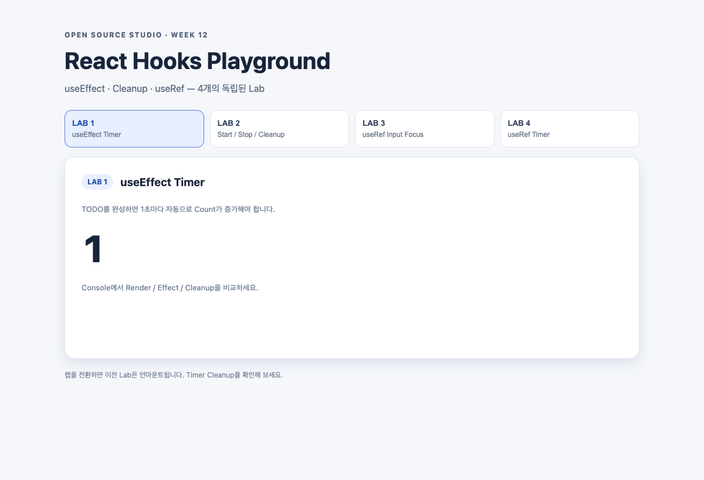
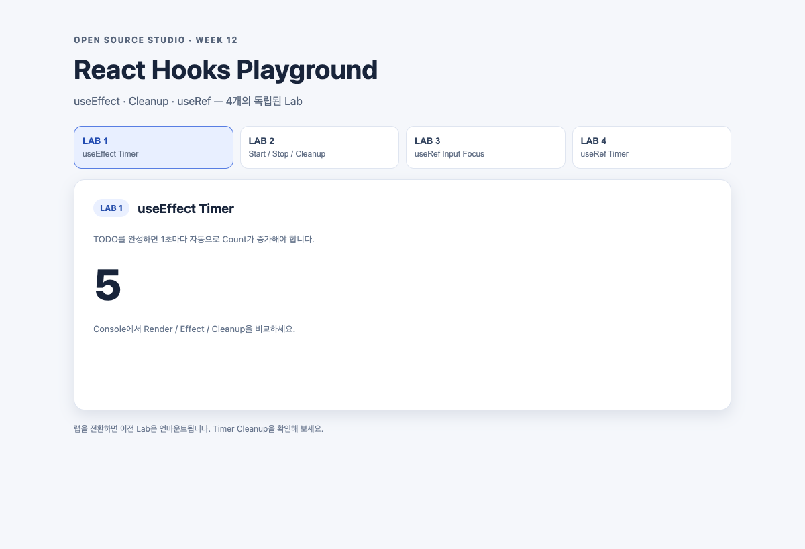
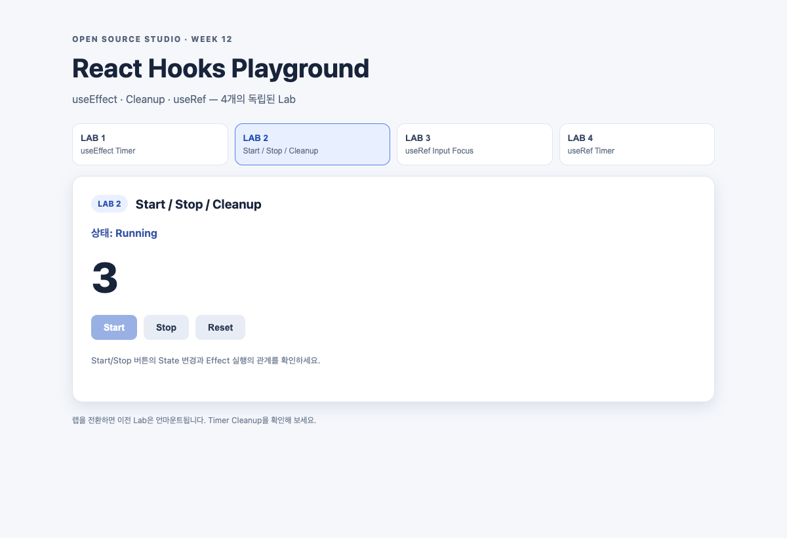
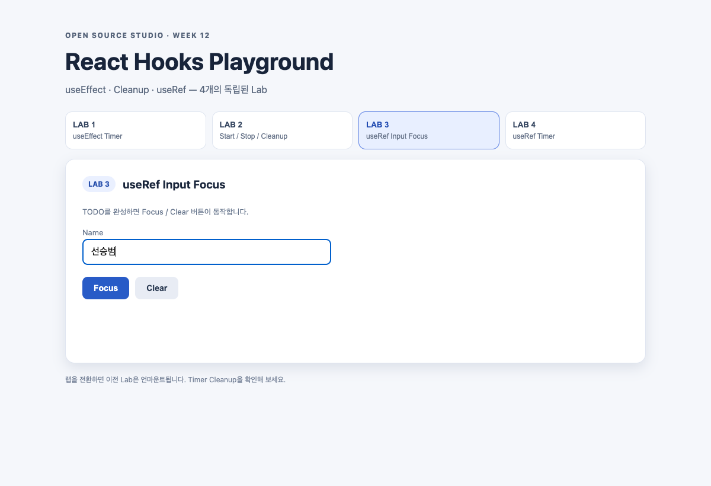
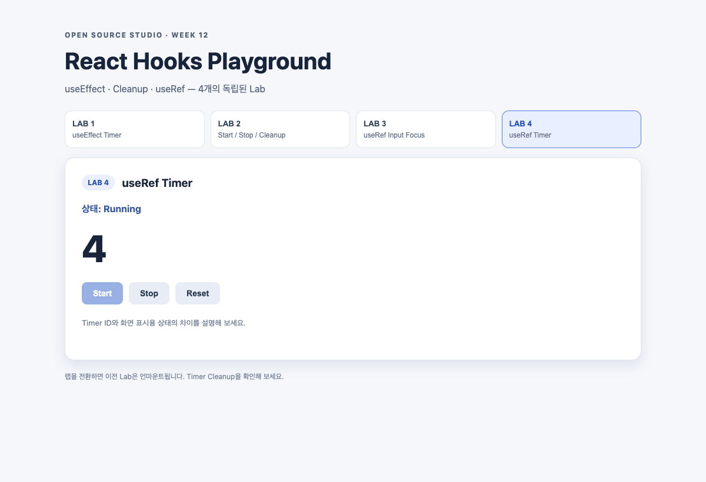

# OSS Week 12 — React Hooks Playground

## 1.Project Information
원본 URL: https://github.com/2026-2-OSS/week12_starter_project
이 프로그램은 4개 LAB이 있으며 각 위쪽 탭을 누르면 그 LAB 으로 페이지가 교체됩니다.
LAB 1,2 는 useEffect 로 Timer를, LAB 3 은 useRef 로 입력창을, LAB 4 는 useRef 로 Timer ID를 관리하며, Timer를 켜 둔 채 탭을 바꾸면 Cleanup 이 Timer를 정리합니다.

## 2.Installation
과제 저장소를 클론한 뒤 cd assign12-c02-22500349 -> npm install -> npm run dev 이후 터미널에 뜬 주소로 들어갔습니다



## 3.Source Code Exploration

### 3-1.Project Structure
메인 파일은 App.jsx 와 components 폴더의 Lab1_EffectTimer.jsx, Lab2_TimerControl.jsx, Lab3_InputFocus.jsx, Lab4_RefTimer.jsx 입니다.
App 은 labs 배열에 LAB 4개의 이름과 컴포넌트를 넣어 두고, active 에 지금 누른 탭을 기억한 뒤 labs.find() 로 고른 LAB 하나만 화면에 그립니다.
각 Lab 은 자기 실습 하나만 맡으며 LAB 1 은 자동 Timer, LAB 2 는 Start/Stop/Reset Timer, LAB 3 은 입력창 Focus/Clear, LAB 4 는 Timer ID를 useRef 로 관리하는 Timer 입니다.

### 3-2.useEffect
useEffect 는 화면을 다 그린 뒤에 실행되는 함수로, 끝의 Dependency Array 에 따라 언제 다시 실행될지가 정해집니다.
[] 이면 처음 한 번, [running] 이면 처음 + running 이 바뀔 때마다, 아예 생략하면 렌더링될 때마다 실행됩니다.
Effect 안에서 함수를 return 하면 이것이 Cleanup 이 되고, Effect 가 다시 실행되기 직전이나 컴포넌트가 사라질 때 실행됩니다.
setInterval 은 컴포넌트가 사라져도 혼자 멈추지 않기 때문에 Cleanup 에서 clearInterval 로 꺼 줘야 합니다.

### 3-3.useRef
useRef(null) 은 { current: null } 모양의 보관함을 만들고, 다시 렌더링되어도 같은 보관함이 유지됩니다.
input 태그에 ref={inputRef} 를 붙이면 React 가 inputRef.current 에 그 input 요소를 넣어 주고, Timer ID 처럼 직접 넣을 값은 timerRef.current 로 넣습니다.
useState 와 가장 큰 차이는 current 를 바꿔도 화면을 다시 그리지 않는다는 점이며 화면에 보여야 하는 count 는 State 로, 화면에는 필요 없는 Timer ID 나 input 요소는 Ref 로 둡니다.

### 3-4.Code Analysis: useEffect와 useRef 관련 주요 코드 각 1개(5~15줄)를 선택하여 동작 원리 설명

```jsx
useEffect(() => {
  if (!running) return;

  const id = setInterval(() => {
    setCount(prev => prev + 1);
  }, 1000);

  return () => {  clearInterval(id); };
}, [running]);
```

Start 를 누르면 running 이 true 로 바뀌고, 화면을 다시 그린 뒤 Effect 가 실행되어 1초마다 count 를 1씩 올리는 Timer 를 만듭니다.
Stop 을 누르면 running 이 false 로 바뀌어 Cleanup 이 먼저 이전 Timer 를 끄고, 새 Effect 는 if (!running) return; 에서 끝나 Timer 를 만들지 않습니다.
setCount(prev => prev + 1) 은 이전 값을 받아 1을 더하는 방식이라 Timer 안에서도 count 가 제대로 올라갑니다.

```jsx
const inputRef = useRef(null);

const focusInput = () => {
  inputRef.current.focus();
};

const clearInput = () => {
  inputRef.current.value = '';
  inputRef.current.focus();
};

<input id="student-name" className="field" placeholder="Enter your name"
  ref={inputRef} />
```

처음에는 input 이 아직 화면에 없으므로 null 로 만들고, ref={inputRef} 로 연결하면 화면을 그린 뒤 inputRef.current 에 실제 input 요소가 들어갑니다.
Focus 버튼은 focus() 로 입력창에 커서를 옮기고, Clear 버튼은 value 를 *''* 로 비운 뒤 다시 focus() 합니다.

## 4.Lab Implementation

### LAB 1. useEffect Timer

```jsx
useEffect(() => {
  const id = setInterval(() => {
    setCount((prev) => prev + 1);
  }, 1000);

  return () => clearInterval(id);
}, []);
```



Dependency Array 를 [] 로 두어 처음 한 번만 Timer 를 만들고, 1초마다 setCount((prev) => prev + 1) 로 count 를 올립니다.
다른 탭으로 옮기면 Cleanup 인 clearInterval(id) 가 실행되어 Timer 가 꺼집니다.

### LAB 2. Timer Start / Stop

```jsx
const reset = () => {
  setRunning(false);
  setCount(0);
};
```



Timer 를 켜고 끄는 부분은 3-4 의 첫 번째 코드이며, Reset 은 running 을 false 로 바꾼 뒤 count 를 0 으로 만듭니다.
running 이 false 가 되면 Cleanup 이 Timer 를 끄기 때문에 Reset 에서 clearInterval 을 따로 부르지 않았고, Start 버튼은 실행 중에는 disabled 되어 Timer 가 두 개 생기지 않습니다.

### LAB 3. Input Focus with useRef



코드는 3-4 의 두 번째 코드이며, Focus 를 누르면 입력창에 커서가 가고 Clear 를 누르면 글자가 지워진 뒤 커서가 입력창에 남습니다.

### LAB 4. Timer with useRef

```jsx
const start = () => {
  if (timerRef.current !== null) return;

  timerRef.current = setInterval(() => {
    setCount((prev) => prev + 1);
  }, 1000);

  setRunning(true);
};

const stop = () => {
  if (timerRef.current !== null) {
    clearInterval(timerRef.current);
    timerRef.current = null;
  }

  setRunning(false);
};
```



start 와 stop 은 서로 다른 함수라서 Timer ID 를 둘이 같이 볼 수 있는 timerRef.current 에 보관합니다.
start 는 보관함이 비어 있을 때(null)만 Timer 를 만들어 중복 실행을 막고, stop 은 Timer 를 끈 뒤 보관함을 null 로 비웁니다.
Reset 은 stop() 후 count 를 0 으로 만들고, useEffect(..., []) 의 Cleanup 에서 탭을 바꿀 때 남은 Timer 를 정리합니다.

## 5.Lab Comparison

### Q1. useEffect의 Dependency Array가 필요한 이유는?
Effect 를 언제 다시 실행할지 정하기 위해서입니다.
배열이 없으면 렌더링될 때마다 실행되어, LAB 1 이라면 count 가 바뀔 때마다(1초마다) Timer 를 지우고 새로 만드는 일이 반복됩니다.

### Q2. Cleanup을 사용하지 않으면 어떤 문제가 발생할 수 있는가?
setInterval 은 컴포넌트가 사라져도 멈추지 않아서, 탭을 옮겨도 Timer 가 뒤에서 계속 돌게 됩니다.
다시 돌아오면 새 Timer 가 하나 더 생겨 count 가 2배로 빨리 오르고, LAB 2 에서는 Stop 을 눌러도 Timer 가 멈추지 않습니다.

### Q3. useState와 useRef의 가장 중요한 차이는?
값을 바꿨을 때 화면을 다시 그리느냐 입니다.
State 를 바꾸면 다시 렌더링되어 화면이 바뀌지만, ref.current 를 바꾸면 값만 바뀌고 화면은 그대로이며, 둘 다 렌더링 사이에 값이 유지되는 것은 같습니다.

### Q4. LAB 2와 LAB 4의 Timer 관리 방식은 어떻게 다른가?
LAB 2 는 useEffect 가 running 이 바뀌는 것을 보고 Timer 를 자동으로 만들고 끄며, Timer ID 는 Effect 안의 id 에 둡니다.
LAB 4 는 start, stop 함수가 Timer 를 직접 만들고 끄며, Timer ID 는 timerRef.current 에 두고 useEffect 는 탭을 바꿀 때 남은 Timer 를 정리하는 데만 씁니다.

## 6.Customizing


## 7.실제 접근 가능한 Vercel URL


## 8.Weekly Review

### 새롭게 배운 내용 3가지
#### useEffect
useEffect 는 화면을 그린 뒤 실행되는 함수이고, 끝의 Dependency Array 에 따라 다시 실행되는 때가 달라지는 점이 새로웠습니다

#### Cleanup
Effect 에서 함수를 return 해 두면 React 가 다음 Effect 직전이나 컴포넌트가 사라질 때 대신 실행해 주며, setInterval 처럼 브라우저에 맡긴 일은 여기서 꼭 꺼 줘야 했습니다

#### useRef
useRef 는 input 요소를 직접 가리키거나(LAB 3) Timer ID 를 기억해 둘 수 있었고(LAB 4), 값을 바꿔도 다시 렌더링되지 않는 점이 useState 와 가장 달랐습니다

### 어려웠던 점과 해결 방법
Stop 을 누르면 if (!running) return; 이 Timer 를 멈춘다고 생각했지만, 실제로 Timer 를 끄는 것은 Cleanup 의 clearInterval 이었습니다

### AI 활용 내용 및 느낀 점